*Performance is a feature.*

I build desktop apps, embedded firmware and tools, usually to replace something slower or heavier.

## Featured

### [MekaWeapons](https://github.com/omeranha/MekaWeapons)

Unofficial Mekanism addon. Adds the Meka-Tana, Meka-Bow and Meka-Gun, each configured with modules at the Modification Station. Supports Better Combat and Epic Fight.

### [Framenion](https://github.com/omeranha/Framenion)

Warframe companion desktop app built with Avalonia UI. Browses equipment, inventory, relics and rivens with live Warframe Market prices, tracks Void Fissures, and reads relic rewards and riven cards off the screen with OCR. Windows and Linux.

### [V9 Pro Control](https://github.com/omeranha/v9pro-control)

Native Windows app that replaces the vendor's Electron app for the MCHOSE V9 PRO headset. The undocumented DSP property layout was mapped by diffing the registry, and settings are applied live through the audio service's `IPolicyConfig` interface. No network access.

### [ESPKeyboard](https://github.com/omeranha/ESPKeyboard)

Wireless USB keyboard bridge over ESP-NOW. An ESP32-S3 reads the keyboard as a USB host, and an ESP8266 presents it to the computer as a USB HID device bit-banged on two GPIOs.

### [Odeon](https://github.com/omeranha/Odeon)

Spotify-style PWA for Navidrome, built with React and TypeScript. Mixes the local library with YouTube Music, plays offline, and adds music through Downtify.

## More projects

| Project | Description |
| --- | --- |
| [profile-autopilot](https://github.com/omeranha/profile-autopilot) | VS Code extension that opens each folder in the profile that fits it, inferred from each profile's extensions. On the [Marketplace](https://marketplace.visualstudio.com/items?itemName=omeranha.profile-autopilot) |
| [terminal-masthead](https://github.com/omeranha/terminal-masthead) | Python terminal viewer with a fixed header, PNG logo support and its own scroll buffer. No dependencies.  |
| [RiftAssistant](https://github.com/omeranha/RiftAssistant) | Lightweight Diablo III overlay with a plugin system |
| [FtpContentManager](https://github.com/omeranha/FtpContentManager) | Content manager for Xbox 360 over FTP |

## Tech stack

**Languages:** C • C++ • C# • Java • Python • TypeScript • JavaScript

**Desktop:** .NET • Avalonia UI • Win32 / COM

**Embedded:** ESP-IDF • FreeRTOS • ESP32 • ESP8266 • ESP-NOW • MQTT

**Web:** React • Node.js

**Reverse engineering:** memory reading • COM/API hooking • protocol mapping

	

